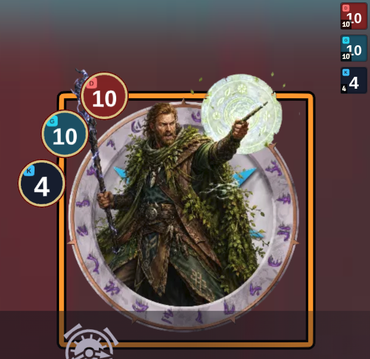

This simple module lets you easily add a counter to a token to keep track of any point system you like. For example, chase points in PF2E. Just drag the point tracker effect from the compendium onto any token. You can increase and decrease the value like any other PF2E effect, such as frightened.

For multiple counters on the same actor, use the `Create Point Tracker` macro from the Point Tracker Macros compendium. Drag it to your hotbar, select one or more tokens, and run it. The macro opens a dialog for tracker name, starting value, minimum value, optional maximum value, and icon style. Each tracker created this way gets a distinct token effect icon path so two trackers with the same value can still both appear in the PF2E effects halo.

Tracker effects created with the macro use the same styled counter image in the selected-token effects list. Existing v2.0.0 trackers can be updated by selecting their token and running `game.pf2ePointTracker.syncTrackerIcons()`.

## Making a Release
* Update the following fields in module.json
    * download: Update the version part of url to match the version tag of the release (e.g. v1.1.1 where 1.1.1 is the version number)
    * version: The version number of this release
* Build module.zip with `npm run build` or `node tools/build-release.js`. The release zip includes:
    * assets/
    * docs/
    * packs/
    * scripts/
    * module.json
    * readme.md
* Check in and push
* Create the release in Github with version number as title and v{version number} as a new tag
* Add module.zip and module.json to the release
* Add a release to the package in Foundry community settings
